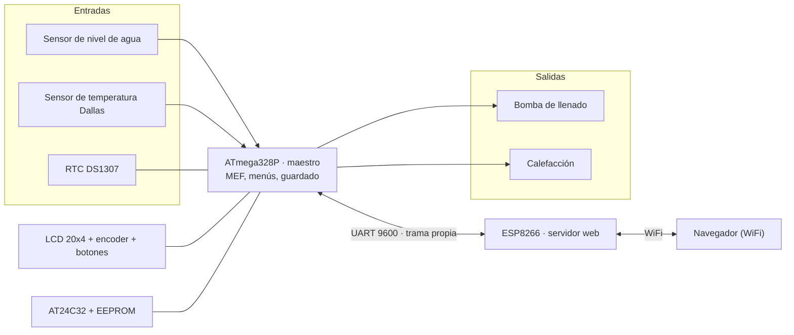

# ☀️ Controlador de Termotanque Solar

Proyecto Final de 6.º año — **Instituto San José A-355** · 2022
**Equipo:** Bartolsic · Schkurko · Castillo

Controlador para un termotanque solar con **interfaz física** (LCD 20×4, encoder y botones) y **acceso web por WiFi**: mide el nivel de agua y la temperatura, comanda el llenado y la calefacción en modo manual o automático, permite programar franjas horarias y publica el estado en una página web servida por el propio equipo.

[](https://www.youtube.com/watch?v=YHdGkORD1rA)

## Funciones

- **Llenado manual y automático** — activación directa desde el equipo o por nivel objetivo.
- **Calefacción manual y automática** — encendido directo o por temperatura objetivo.
- **Programación horaria** — hasta 3 programas (hora + nivel + temperatura objetivo), editables desde la web.
- **Interfaz física** — LCD 20×4 con caracteres personalizados (barras de progreso, íconos y reloj), encoder rotativo y botones; menú básico y avanzado, con regreso automático a *standby* por inactividad.
- **Interfaz web** — estado en vivo y configuración desde el navegador, con la web alojada en el propio ESP8266 (LittleFS).
- **Configuración WiFi desde el equipo** — el SSID y la contraseña se cargan con el encoder, sin reprogramar.
- **Persistencia** — parámetros y programas sobreviven a los cortes de energía (EEPROM interna + AT24C32).
- **°C / °F** — conversión seleccionable.

## Arquitectura

Requisito del proyecto: el **ATmega328P (Arduino UNO) es el maestro** y concentra toda la lógica de control. El **ESP8266** actúa como esclavo de comunicación: sirve la web y se comunica con el maestro por UART con un protocolo propio.



## Hardware

| Bloque | Componente |
|---|---|
| Control | Arduino UNO (ATmega328P) como maestro; ESP8266 como módulo WiFi |
| Interfaz | LCD 20×4 I2C, encoder rotativo, 6 pulsadores |
| Sensores | Sensor de nivel (analógico), sensor de temperatura Dallas, RTC DS1307 |
| Memoria | AT24C32 (I2C) + EEPROM interna del 328P |
| Salidas | Relés HJQ-15F (bomba y calefacción) comandados por transistores |
| Fuente | Transformador 12 V 1 A + regulador LM7805 |
| Mecánica | Gabinete y soportes impresos en 3D (Fusion 360) |
| PCB | Placas diseñadas en KiCad (dos revisiones) |

Los datasheets, pinouts y la lista de materiales completa están en las carpetas `other stuff/` y `Datos&cosas/`.

## Firmware

| Programa | Contenido |
|---|---|
| `Codig final UNO` | Firmware del maestro: **~2.200 líneas** de C++ con máquina de estados, menús, caracteres e íconos personalizados del LCD, lectura de sensores, guardado/carga de configuración y protocolo serie. |
| `Codigo final esp` | Firmware del ESP8266: servidor web asíncrono + páginas en LittleFS (estado, programación horaria, configuración) y comunicación serie con el maestro. |

Entre ambos hay un **protocolo UART propio a 9600 baud** (comandos numerados con buffers de recepción escritos a mano en el 328P).

Todos los proyectos usan **PlatformIO** (framework Arduino). Librerías principales: `LiquidCrystal_I2C`, `DallasTemperature` + `OneWire`, `RTClib`, `AT24CX`, y del lado del ESP `ESPAsyncWebServer` + `LittleFS`.

## Estructura del repositorio

```
Proyecto Final/
├── Programa/
│   ├── Codigo final/          # firmware definitivo (UNO + ESP)
│   └── Pruebas modulos/       # pruebas por módulo: encoder, RTC, I2C, UART, WiFi, guardado…
├── Circuitos PCB/             # KiCad: esquemáticos y placas (V1 y V2)
├── Diseños 3D/                # gabinete y soportes (Fusion 360 + STL)
└── Precio.xlsx
Datos&cosas/                   # diagramas de flujo/hardware/software (draw.io) y notas
other stuff/                   # datasheets y pinouts de referencia
```

## Cómo compilar

Con [PlatformIO](https://platformio.org/) instalado (CLI o extensión de VS Code), desde la raíz del repositorio:

```bash
# Firmware del maestro (UNO)
pio run -d "Proyecto Final/Programa/Codigo final/Codig final UNO"

# Firmware del ESP8266 (incluye las páginas web embebidas en LittleFS)
pio run -d "Proyecto Final/Programa/Codigo final/Codigo final esp"
pio run -d "Proyecto Final/Programa/Codigo final/Codigo final esp" -t uploadfs
```

## Equipo

Desarrollado durante 2022 por **Bartolsic, Schkurko y Castillo** para el Instituto San José A-355 (más de 550 commits entre marzo y noviembre). Las correcciones menores de mantenimiento de 2025 (typo en el nombre de un archivo, robustez del lector serie) están identificadas en el historial de commits.
